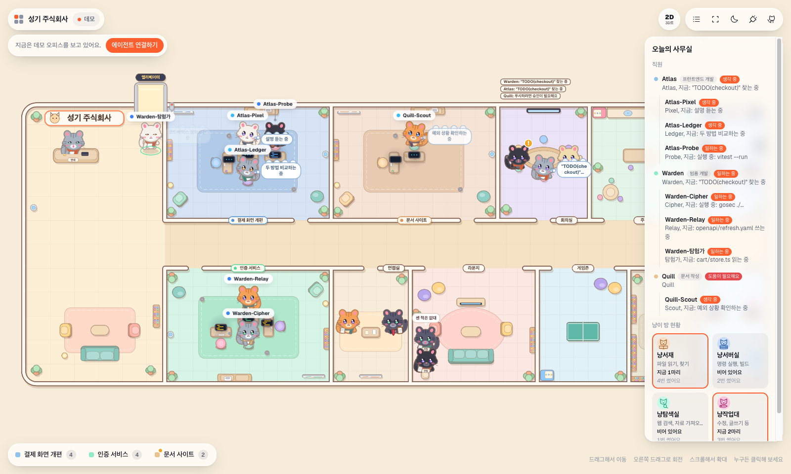
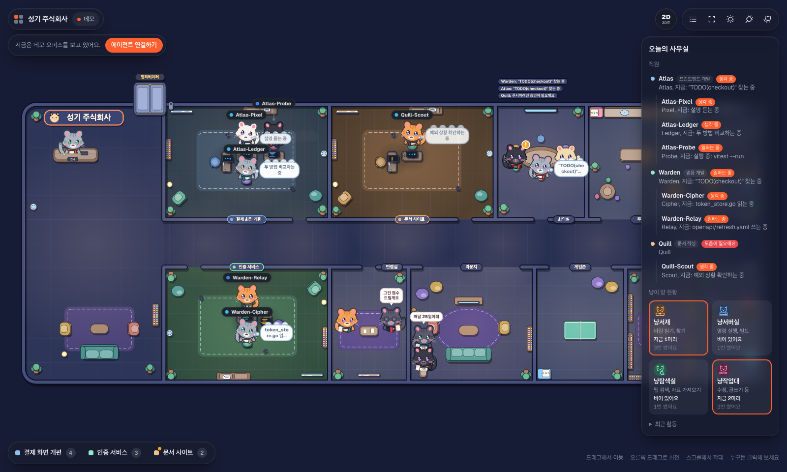

# AI Office

A live 2D office for your coding agents, staffed by cats.

Every agent becomes a cat with its own desk. Each project or team gets its own room along a corridor, next to a kitchen, meeting room, lounge and a few tool rooms (a library for reading files, a server room for shell commands, a search room for the web, a work bench for edits). You can watch cats step out of the elevator, find their desk, type, think, show an amber badge when they need you, and send letters to each other when they talk. Click anyone to see exactly what they are doing.

Works with **Claude Code**, **Codex**, **Cursor**, and anything else that can send an HTTP request.

**Live demo:** once GitHub Pages is switched on for this repository it is served at <https://seonggi.github.io/ai-office/> (runs in your browser, no install). Until then, run `npm run demo` as described below.





A 3D view (three.js) from the original project is still included. Press the **2D / 3D** button in the top bar, or add `?view=3d` to the URL. 2D is the default.

## Quick start

AI Office is not published to npm, so install it from source (Node 20 or newer). The command line tool is still called `agent-floor`, after the original project it grew from, and so are the `AGENT_FLOOR_*` variables:

```bash
git clone https://github.com/SeongGi/ai-office
cd ai-office
npm install
npm run build        # builds the web app into dist/
npm link             # puts the `agent-floor` command on your PATH
agent-floor setup claude --write
```

Do not run `npm i -g agent-floor`: that name belongs to somebody else's package, if it exists at all. Without `npm link`, replace `agent-floor` in every command below with `node /path/to/ai-office/bin/agent-floor.mjs`.

After that, the next time a Claude Code session starts, AI Office opens by itself in its own desktop window (no browser). Close the window and it keeps listening from the menu bar; use **Quit (pause auto-open for 6 hours)** in the menu bar icon when you want quiet. Run `agent-floor` any time to open it yourself.

Start a Claude Code session in any project. A cat walks into a room named after the project folder, sits down, and starts working. When it spawns a subagent, a new teammate walks in, gets briefed by letter, works at its own desk, and reports back.

No agents yet? Click **Watch demo**, or run `agent-floor demo` in a second terminal.

## What you see

| On the floor | Means |
| --- | --- |
| A room | One project, or whatever `team` you send. Its name is above the door. |
| A cat at a desk | One agent. The lead sits at the head of the desk pod. |
| Typing | `working`: running a tool. The monitor shows the tool and what it is doing. |
| Thought bubble | `thinking` |
| Amber badge | `waiting`: it needs you |
| Head shake, red badge | `error` |
| Little hop, green check | `done` |
| Idle pose | `idle` |
| A letter travelling across the floor | A message from one agent to another |
| Walking out of the elevator, down the corridor | An agent joining (or, in reverse, leaving) |
| A cat in a tool room | It is using a tool: reading files, running a command, searching the web or editing |

A side panel lists every agent with what it is doing now, and four room cards count how many cats are in each tool room.

**Controls:** drag to pan, scroll to zoom, click an agent or a room. `F` frames everyone, `[` and `]` step through agents, `T` switches day and night, `Esc` closes things. On touch: one finger pans, two fingers zoom.

## Connect your tools

### Claude Code

```bash
agent-floor setup claude --write     # merges hooks into ~/.claude/settings.json (backup kept)
agent-floor setup claude --project   # prints a snippet for .claude/settings.json in this repo
```

Uses `SessionStart`, `UserPromptSubmit`, `PreToolUse`, `PostToolUse`, `PostToolUseFailure`, `Notification`, `Stop`, `SubagentStop`, `PreCompact` and `SessionEnd`. Subagents spawned with the Task tool get their own desks and their tool calls show up on their own screens.

### Codex

```bash
agent-floor setup codex
```

Prints the `notify` line for `~/.codex/config.toml`. Codex reports once per finished turn. If your Codex build supports Claude-style hooks, point them at `agent-floor hook codex` and you get live tool activity too.

### Cursor

```bash
agent-floor setup cursor --write     # ~/.cursor/hooks.json
agent-floor setup cursor --project   # .cursor/hooks.json in this repo
```

Only observing hooks are installed. AI Office never answers a permission prompt for you.

### Anything else

Post JSON to `http://localhost:4317/events`:

```bash
curl -X POST localhost:4317/events \
  -H 'content-type: application/json' \
  -d '{"type":"tool","agent":"bot-1","team":"Payments","tool":"Bash","activity":"Running tests"}'
```

Or from a shell script:

```bash
agent-floor emit --agent bot-1 --team Payments --status working --activity "Running tests"
agent-floor emit --agent bot-1 --to bot-2 --text "Tests are green"
```

The full event format is in [docs/protocol.md](docs/protocol.md). More integration notes, including LangGraph and CrewAI style frameworks, are in [docs/integrations.md](docs/integrations.md).

## Configuration

| Variable | Default | Used by |
| --- | --- | --- |
| `AGENT_FLOOR_PORT` | `4317` | server, hooks |
| `AGENT_FLOOR_HOST` | `127.0.0.1` | server |
| `AGENT_FLOOR_URL` | `http://127.0.0.1:4317` | hooks, `emit`, `demo` |
| `AGENT_FLOOR_TEAM` | project folder name | hooks: put this session in a named room |
| `AGENT_FLOOR_NAME` | `Claude`, `Codex`, `Cursor` | hooks: the lead's display name |
| `AGENT_FLOOR_AUTOLAUNCH` | `1` | set to `0` so hooks never open the app |
| `AGENT_FLOOR_SEED` | `1` | set to `0` so the server does not read the Claude Code sessions already open on this machine |
| `AGENT_FLOOR_TOKEN` | none | if set on the server, every request must carry it; hooks and `emit` send it as a bearer token (see [docs/deploy-mini.md](docs/deploy-mini.md), written in Korean) |

Group several repos into one room by giving them the same `AGENT_FLOOR_TEAM`.

## Privacy and safety

- The server binds to `127.0.0.1` and only answers loopback host names.
- `POST` requires `Content-Type: application/json`, so web pages cannot fire simple cross-site requests at it. CORS is limited to localhost origins.
- Hooks time out after 1.2 seconds, swallow every error and always exit 0. If the floor is down, your agents never notice.
- Agent activity is kept in memory only and is not sent anywhere else. Activity text is clipped to 280 characters. The only files the server writes are the audit log, custom agent names and terminal routes under `data/` (git-ignored), and only when you use the remote-control features (closing a session or sending it an instruction).
- On start the server also reads which Claude Code sessions are already open on this machine, so their project names show up in the office right away. Set `AGENT_FLOOR_SEED=0` to turn that off.

## The desktop app

`agent-floor` (or the first hook event when nothing is running) starts the floor and opens it as an Electron window. If Electron is not available, it falls back to a Chrome or Edge app window, and then to your default browser. Only one copy ever runs: parallel subagents share a launch lock. `agent-floor start` runs just the server, with no window, if you prefer a browser tab at http://localhost:4317.

## Performance

The 2D floor is drawn on one canvas. Add `?stats` to the URL (or run `agent-floor demo --agents 60` for a stress test) to see frame time.

## How it works

```
Claude Code / Codex / Cursor hooks ──┐
agent-floor emit, curl, your code ───┼──► POST /events ──► reducer ──► GET /stream (SSE) ──► browser
                                     │                       │                                │
                                     └─ adapters/*.mjs       └─ shared/protocol.js ◄──────────┘
                                        map native payloads     same reducer runs on both sides
```

- `server/` is a zero-dependency Node HTTP server.
- `shared/protocol.js` is the event reducer, used verbatim by the server and the browser, so a snapshot plus the stream always matches.
- `adapters/` turn each tool's hook payload into floor events. They are pure functions with tests.
- `src/world2d/` is the 2D office: rooms, desks, the cats, letters and the camera.
- `src/world/` is the optional three.js 3D scene from the original project.
- `src/ui/` is the HUD: side panel, name tags, speech bubbles, the agent card and the connect sheet.
- `desktop/` is the Electron shell: native window, tray icon, single instance, auto-launch state.

## Develop

```bash
git clone https://github.com/SeongGi/ai-office
cd ai-office
npm install
npm run dev        # floor server on :4317 + Vite on :5173
npm run demo       # in another terminal, stream fake agents
npm test           # protocol, adapters, server
npm run build      # typecheck + production build into dist/
```

`npm run build:pages` builds a demo-only version into `dist-pages/` for GitHub Pages. The included workflow publishes it on every push to `main`.

See [CONTRIBUTING.md](CONTRIBUTING.md) for how the scene is put together and what makes a good adapter.

## Credits

This project started from [develop212/agent-floor](https://github.com/develop212/agent-floor) (MIT). The 3D office (`src/world/`), the event protocol and the adapters come from that project.

The 2D office (`src/world2d/`), the cat characters, the break-room and farewell scenes, and the later changes were made in this repository by SeongGi, together with Claude Code. Along the way I looked at other people's ideas for inspiration, but I did not copy their code.

## License

MIT. The original copyright notice is kept in [LICENSE](LICENSE), and the changes in this repository are added under the same license.
